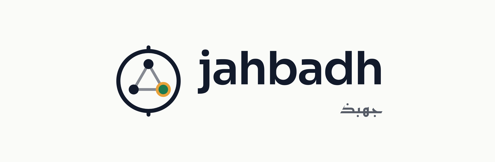

<p align="center">
  <picture>
    <source media="(prefers-color-scheme: dark)" srcset="docs/brand/jahbadh-lockup-dark.png">
    
  </picture>
</p>

<p align="center"><b>AI agents that explain the game and prove every word.</b></p>

Jahbadh is my entry for the Microsoft x Premier League *Inside the Game* developer hackathon (challenge: Synthetic Match Insights Engine for Premier League Studio). It's a match desk run by AI agents that watches a synthetic football match and explains it: live commentary, tactical breakdowns, heatmaps and recaps. The twist is that every claim has to be backed by the data, and you can click any sentence to see the events and numbers behind it.

*Jahbadh* is an Arabic word for someone who truly masters a craft. Here that means understanding simulation, tactics and writing all at once.

> 🚧 Work in progress. The simulator, the tactical analytics, the agent desk and the live desk UI are done. The evaluation with planted false claims and the Azure deployment are coming next.

## What's working so far

**A synthetic match simulator.** It plays a full 90-minute match one second at a time, with fictional teams and players (no real clubs or players anywhere). Every match gives you:
- about 1,500 events: passes, shots with xG, tackles, interceptions, pressure, fouls, cards, subs, goals
- 1 Hz tracking data for all 22 players and the ball (about 124,000 rows)
- scripted tactical moments for demos, like a formation switch on the hour (61' on the match clock)
- realistic numbers, checked by tests: about 850 passes at 79%, 30 shots, 3 xG, PPDA in real-world ranges
- reproducibility: same seed, same match, every time

**A tactical analytics library.** Pure Python, no AI guessing. Every result carries the evidence it was computed from (event IDs and tracking frames), so an agent can never make up a number:
- xG totals and timelines, field tilt, PPDA (pressing intensity), momentum
- heatmaps, average positions, team shape (width, length, defensive line)
- zone overloads, pass networks, midfield control
- player impact (expected goal involvement, progressive passes, ball wins and more) with rankings
- before/after comparisons around any moment
- match stats for each half and the whole match (shots inside and outside the box, goals, xG, fouls, cards, passes), shot maps and attacking sides

**A multi-agent match desk.** Built on Microsoft Agent Framework and a `gpt-5-mini` deployment on Microsoft Foundry. For every key moment (goals, big chances, cards, tactical changes, momentum swings, check-ins, full time and player spotlights) a workflow runs:
- an **Analyst** and a **Tactical** agent that call the analytics library as tools and only see the match up to that moment
- a **Writer** that turns their findings into one-sentence claims, each tagged with the metrics and events behind it
- a **Referee** that checks every claim, first with plain Python and then with an LLM judge, and sends rejected claims back for one rewrite
- **Persona** rewrites for a casual fan or a fantasy player, re-checked so no new fact sneaks in
- **Localization** into Arabic and Spanish with Azure AI Translator, with a check that every number and name survived

## Try it

To put it on Azure (Container Apps, keyless sign-in, traces in Foundry), follow the step-by-step [deploy guide](docs/deploy.md).

You need Python 3.13.

```bash
py -3.13 -m venv .venv
.venv\Scripts\pip install -e .[dev]
```

Generate the demo match (seed 42 with the scripted storyline):

```bash
.venv\Scripts\python -m jahbadh.simulator --seed 42 --demo-storyline
```

Draw preview charts for it (heatmaps before and after the formation switch, average positions and momentum):

```bash
.venv\Scripts\python scripts\preview_match.py data\generated\match-042 --out previews
```

Run the tests:

```bash
.venv\Scripts\python -m pytest -q
```

The full suite takes about 3 minutes, because some realism checks simulate dozens of matches. One test is a known, documented gap and shows up as an expected failure (xfail). The live Azure tests are skipped unless you ask for them (see below), so the suite never calls a model or spends credit.

## Run the agent desk

The desk needs a Microsoft Foundry model deployment, and Azure AI Translator for Arabic and Spanish. Copy `.env.example` to `.env` and fill in your keys. `.env` is gitignored, so your keys never leave your machine.

Run the whole desk over the demo match, in every persona and language:

```bash
.venv\Scripts\python -m jahbadh.agents data\generated\match-042
```

Or try a few moments first, in English only:

```bash
.venv\Scripts\python -m jahbadh.agents data\generated\match-042 --limit 5 --languages en --personas pundit
```

It writes `desk.json` next to the match, with every approved claim, every persona and language version, every rejected draft with its reasons, and the metrics behind each claim. It also prints the first-draft pass rate, rejections by layer and the time per moment. To see the per-moment workflow as a Mermaid diagram without calling any model, add `--mermaid`.

To check the real Azure services (a few cents):

```bash
$env:JAHBADH_LIVE=1; .venv\Scripts\python -m pytest tests\agents\test_live.py -m live -q
```

## Run the desk

The desk is a FastAPI server that streams the match and the agents' feed over Server-Sent Events, plus a React app that shows it all: the event stream, the tactical pitch and the verified feed, where you can click any sentence to see its evidence. You need Python 3.13 and Node 22.

```bash
.venv\Scripts\pip install -e .[dev]
npm ci --prefix web
npm --prefix web run build
.venv\Scripts\python -m uvicorn jahbadh.api.app:create_app --factory --port 8000
```

Then open http://127.0.0.1:8000. The server serves the built app, and the desk starts playing straight away.

**Replay is the default, and it's real.** It plays the demo match with a desk run that was precomputed by the very same agents (`data/showcase/match-042/desk.json`, never edited by hand). It's free and instant, and you can change the speed, skip to the next moment, switch persona and language, pick a favourite club, follow a player or track one metric, and open the full-time recap.

**Live mode** plays a fresh match while the agents really work on each key moment. It calls the model, so it's off unless you switch it on, and it has a daily limit shared by everyone. Add these to `.env` (see `.env.example`):

```bash
JAHBADH_LIVE_MODE=on
JAHBADH_LIVE_PER_DAY=3
```

Each fresh match and each requested spotlight counts as one live run. The count is kept in `data/state/live.json`, so a restart doesn't reset it.

**While working on the UI**, run the API and the Vite dev server side by side. Vite forwards `/api` to port 8000:

```bash
.venv\Scripts\python -m uvicorn jahbadh.api.app:create_app --factory --port 8000
npm --prefix web run dev
```

and open http://localhost:5173. The web tests run with `npm --prefix web run test`.

## Overlay feed for broadcast graphics

Alongside the desk, every match has a timed cue feed that a broadcast graphics system could draw over the pictures: goals, cards, substitutions, formation and press changes, big or fast shots, new top speeds, distance milestones, changes in the game rhythm, and the Referee-approved desk lines. Each cue says when to show it, for how long, what to say in English, Arabic and Spanish, and which events and metrics back it up. No model is called to make them.

- `GET /api/overlay/schema` is the JSON schema for a cue.
- `GET /api/replay/match-042/overlay` gives every cue for the showcase match as a list.
- `GET /api/replay/match-042/overlay/stream?speed=6` streams only the cues, on time, over Server-Sent Events.
- In live mode, `GET /api/live/{run_id}/overlay` and `/overlay/stream` do the same, and never run past the match clock.

Here's a real cue from the showcase match:

```json
{
  "id": "event-213",
  "match_time": 885.0,
  "minute": 15,
  "type": "goal",
  "team_id": "NBR",
  "player_id": "NBR-72",
  "value": null,
  "unit": null,
  "text": {
    "en": "GOAL · Kian Jansen (Northbridge FC)",
    "ar": "هدف · Kian Jansen (Northbridge FC)",
    "es": "GOL · Kian Jansen (Northbridge FC)"
  },
  "duration_s": 12.0,
  "event_ids": [212, 213],
  "metric_ids": [],
  "source": "event",
  "synthetic": false,
  "precomputed": true
}
```

In the desk, switch on **Broadcast overlay preview** above the pitch to see the cues as lower-thirds while the match plays.

## What's not in scope

- **No video auto-eventing.** There's no video feed anywhere in Jahbadh. Every event comes from the synthetic match simulator, so nothing is detected from pictures.
- **Some numbers come from the simulator's own models, and they're labelled that way.** Shot speed, the pass success odds (and the pass difficulty built from them) and everything tracking-based (distance, top speed, sprint records) are synthetic. Overlay cues built on them carry `"synthetic": true` and show a *Simulated* tag in the preview, and the desk notes it wherever it shows running numbers or pass difficulty, so nobody mistakes them for measured values.

## How the desk checks itself

Every claim carries its evidence: the metric ids it relies on, the event ids, and each number exactly as it is written. The Referee checks it in two layers.

1. **Plain Python, no AI.** Every id has to exist and can't come from later in the match. Every number has to match its metric at the precision it's written ("79%" passes for 0.787, "1.2" fails for 1.13), only real shares can be written as percentages, minutes follow the broadcast clock (60:00 is 61'), and any number nobody can back up gets the claim rejected.
2. **An LLM judge.** It reads the same evidence and checks the meaning: direction words, causes (midfield control is never allowed as one), names, time phrases and superlatives.

A rejected claim goes back to the Writer once with the reasons. If the rewrite fails too, it's dropped. Every rejection is kept on purpose, so you can see the checking happen. In one real run on the demo match, the Referee stopped the Writer from calling a midfielder-for-winger swap "like-for-like", and from passing off a raw momentum number as a percentage.

## The data

Everything is synthetic and football-realistic. The schema and coordinate system are documented in the dataset README written by `export_schema()` in `src/jahbadh/simulator/io.py`. In short, the pitch is 105 x 68 m, the home team always attacks toward x = 105, and a match is exactly 90 minutes.

## Project docs

- Design: `docs/superpowers/specs/2026-10-17-jahbadh-design.md`
- Build plans: `docs/superpowers/plans/2026-10-17-plan-1-data-foundation.md`, `docs/superpowers/plans/2026-10-17-plan-2-agents.md` and `docs/superpowers/plans/2026-10-18-plan-3-desk.md`
