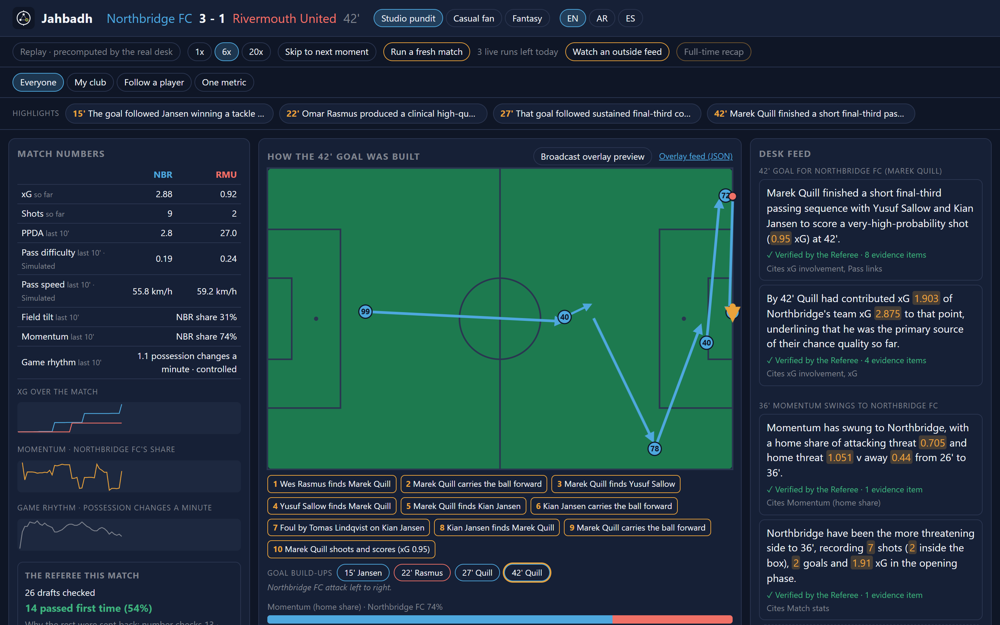
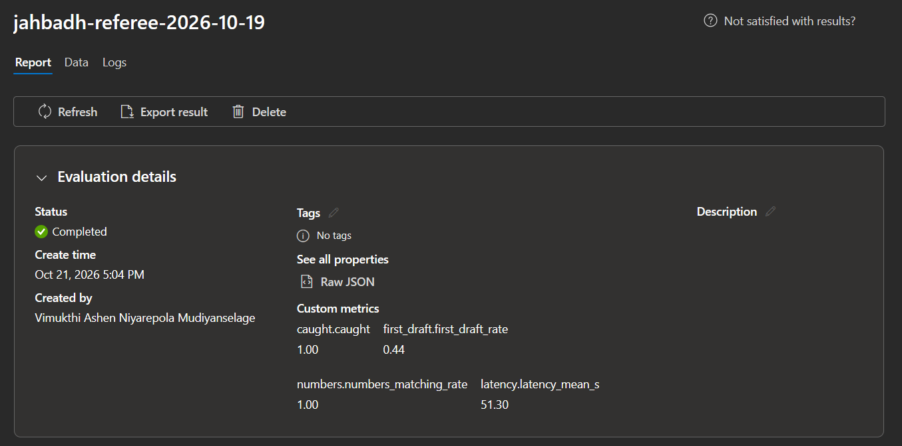
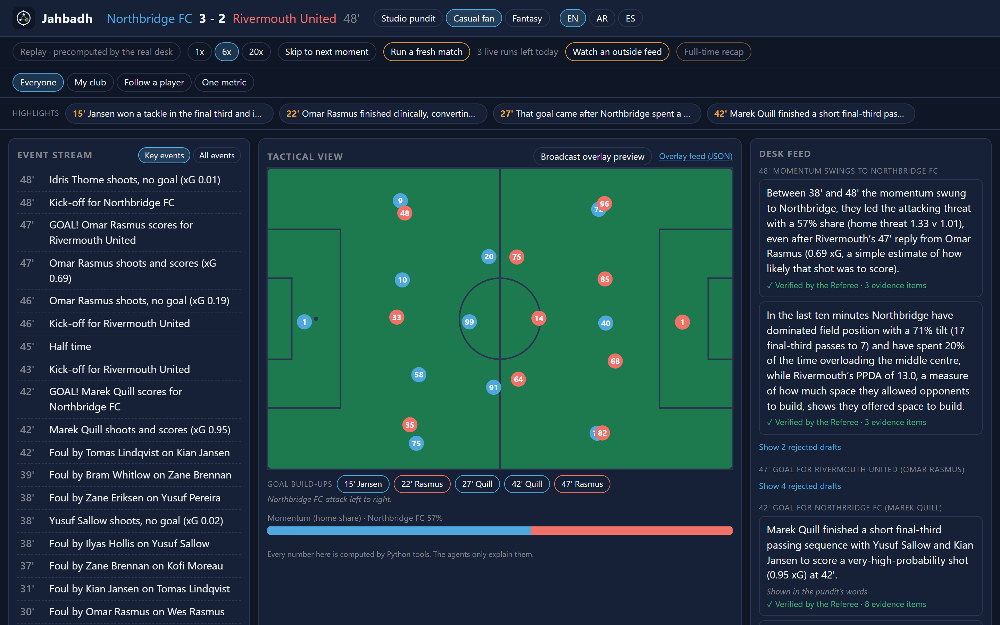
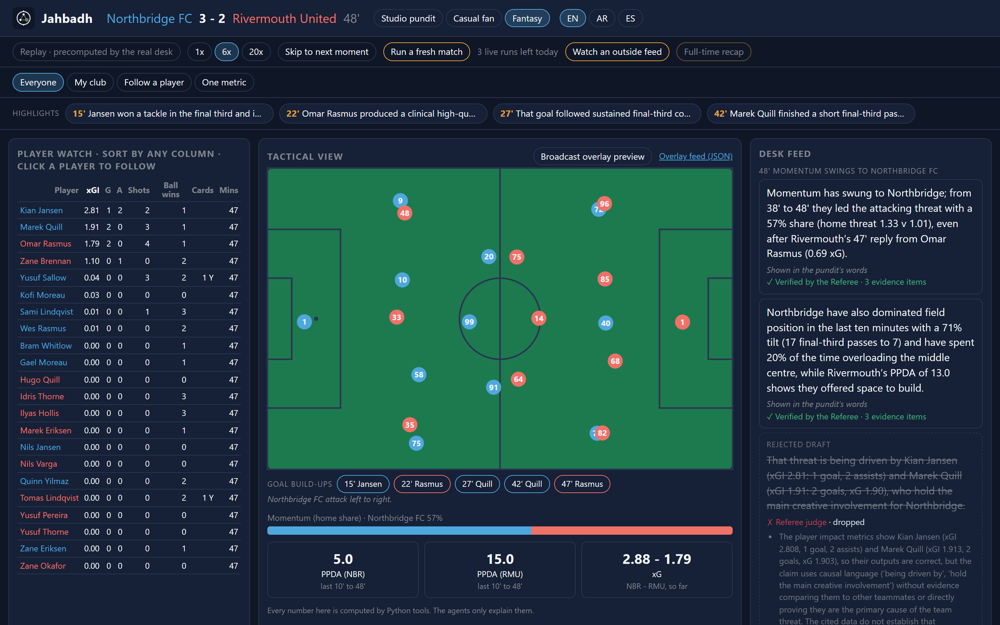
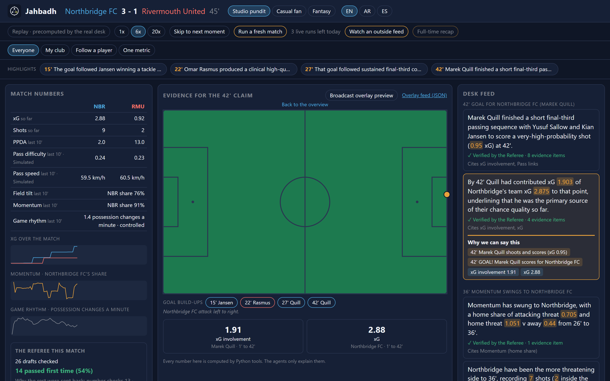
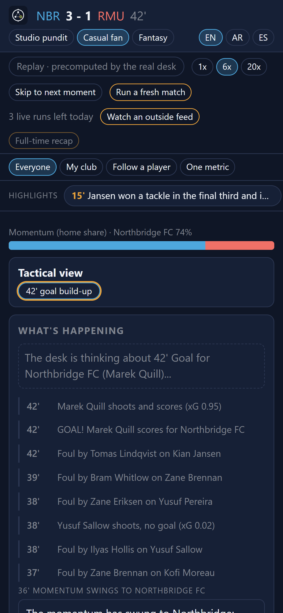
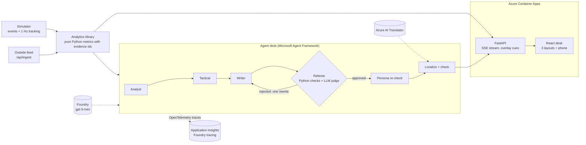
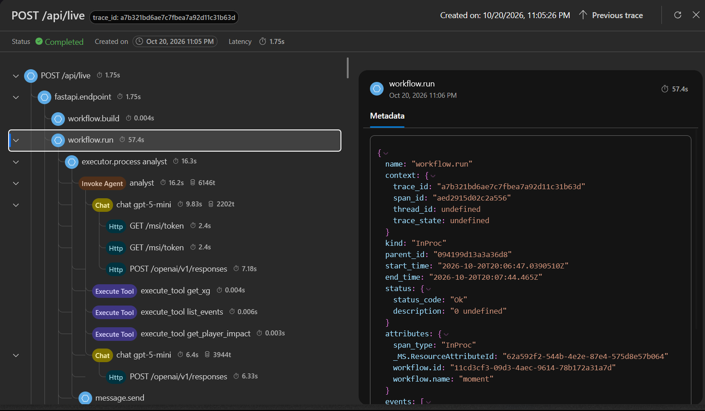

<p align="center">
  <picture>
    <source media="(prefers-color-scheme: dark)" srcset="docs/brand/jahbadh-lockup-dark.png">
    
  </picture>
</p>

<p align="center"><b>AI agents that explain the game and prove every word.</b></p>

<p align="center">
  <a href="https://github.com/pyyroo-a/jahbadh-ai/actions/workflows/ci.yml"></a>
</p>

<p align="center"><b><a href="https://ca-jahbadh.nicesand-4113ef71.uaenorth.azurecontainerapps.io">Open the live desk</a></b> · it starts playing straight away, no sign-in</p>

Jahbadh is my entry for the Microsoft x Premier League *Inside the Game* developer hackathon (challenge: Synthetic Match Insights Engine for Premier League Studio). It's a match desk run by AI agents that watches a synthetic football match and explains it as it happens: live lines, tactical breakdowns, heatmaps, recaps and a replay of how every goal was built. The twist is that **every claim has to be backed by the data**. A Referee agent checks each sentence before anyone sees it, and you can click any sentence to see the exact events and numbers behind it.

*Jahbadh* is an Arabic word for someone who truly masters a craft. Here that means understanding simulation, tactics and writing all at once.



## What you can do with it

- **Watch a match with a studio desk.** The match plays at 6x (or 1x, or 20x). The desk writes about every key moment: goals, big chances, cards, tactical switches, momentum swings, check-ins and full time.
- **Pick who you are.** A *Studio pundit* gets the numbers and the Referee's working, a *Casual fan* gets plain words and a calm view, and a *Fantasy* player gets a player table and can follow anyone. Every line comes in English, Arabic and Spanish.
- **Click any sentence.** The pitch shows that claim's evidence: the events it cites and the metrics it rests on, drawn where they happened.
- **See how each goal was built.** When a goal goes in, the tactical view replays the move like a TV graphic: every pass and carry as an arrow, in order, then the shot. The "Goal build-ups" row lets you watch any goal again.
- **Make it your own.** Follow your club, follow one player, or track one metric across the match.
- **Run a fresh match live** (3 a day for everyone, it calls the real model), or **watch an outside feed** that sends its events over HTTP, the way a real data provider would.

## How well the Referee works

I tested the Referee the hard way: 20 fresh matches, a real desk run on each, and 50 false claims planted into real drafts (wrong numbers, wrong players, made-up events, wrong teams and wrong minutes). The full report is in [`data/eval/2026-10-19-referee/report.md`](data/eval/2026-10-19-referee/report.md), and these lines are quoted from it word for word:

> The Referee caught 47 of 47 planted false claims across 20 matches.
>
> Real first drafts that passed the Referee unchanged: 196 of 442 (44%).

| Planted false claim | Caught |
|---|---|
| Wrong number | 10 of 10 |
| Wrong player | 10 of 10 |
| Made-up event | 10 of 10 |
| Wrong team | 7 of 7 |
| Wrong minute | 10 of 10 |

- **Where they were caught:** 20 by the plain Python number and ID check, 27 by the LLM judge.
- **3 plants found no draft to plant into** (all "wrong team"), so 47 were planted, not 50, and they aren't counted.
- **Published numbers:** 336 of 336 numbers in the published claims still pass the number check.
- **Speed:** 51.3 seconds per key moment on average (median 49.7, 90th percentile 61.3, slowest 118.0), for 160 key moments with 0 failures.
- **Cost:** about $4.93 for the whole eval (1,304 model calls).
- **Less than half of the first drafts get through untouched (44%).** That's the point: the Writer is creative, and the Referee sends the rest back once with reasons. A rewrite that still fails is dropped, never published.

**The showcase, counted as it is.** The replay you see on the live site is a real desk run from 18 Oct, never edited. Its 29 key moments made 66 published claims, 43 of 83 first drafts passed straight away (52%), and the Referee sent back drafts 108 times (31 by the number check, 26 by the judge, 39 by the persona re-check and 12 by the translation check). When the eval checked the showcase again with today's number check, **17 of its 66 published claims failed it.** They stay, because the showcase is real output, and that's the honest number.

The same eval is also uploaded to the Foundry project as an evaluation run (`python -m jahbadh.eval upload`), with metrics equal to the report: caught 1.00, first drafts 0.44, numbers 1.00, latency 51.30 s.



## How fast lines arrive

- **What happened** (passes, shots, goals, cards) shows in the event stream the second it happens, in all three languages. These lines come from templates, so they're instant and cost nothing.
- **The desk's checked lines take real work.** Each key moment runs the whole chain in order: Analyst, Tactical, Writer, Referee, a rewrite and a second check when needed, then the persona and language versions. That took 51.3 seconds on average in the eval. The Referee is the slow, careful part, and it's the part that makes the lines worth reading.
- **In replay,** the precomputed lines land 20 match seconds after their moment, so you can watch the desk "think" and then publish.
- **In a live match, the match waits for the desk.** The first live run on Azure (20 Oct) worked end to end with no errors (11 key moments, 55.7 s each), but at 6x the checked lines landed about 6 match minutes after the moment. Watching as a fan, that felt like old news. So now, when the clock reaches a key moment, a live match drops to real time (1x) until that moment's checked line is published, then speeds back up to 6x. Everyone sees it: the minute turns amber with a "1x · desk checking" pill, the pundit sees the desk's finished steps tick by, and each line is stamped with when it landed. A stuck moment can never hold the match for more than 120 seconds, and the slow-down never starts early, so it can't give away that something is about to happen.

## Three ways to watch

| Casual fan | Fantasy (player watch) |
|---|---|
|  |  |

The Studio pundit's view is the one at the top: match numbers, sparklines and the Referee's box on the left, rejected drafts with their reasons in the feed.

**Click any sentence to see why it's true.** Here the pundit clicked "By 42' Quill had contributed xG 1.903...": the pitch shows the shot and the goal it cites, the tiles show the two metrics, and "Why we can say this" lists every piece of evidence.



**On a phone,** every view stacks into one column. The tactical view folds into a card, and when a goal goes in it glows with "42' goal build-up" instead of jumping open, so nobody loses their place in the feed.

<p align="center"></p>

## Goal build-ups

Every goal carries its move. The server walks back from the shot to the moment the scoring team won the ball: their completed passes and carries, their own winning tackle or interception, and a free kick won along the way. The browser only draws what it's sent. In the showcase, Quill's 42' goal is ten steps, from Wes Rasmus's pass in his own half to a free kick by the corner flag and Quill's finish. Some goals are just a shot from a loose ball, and the replay says so plainly.

The data has no spot inside the goal for a shot, so every shot arrow ends at the centre of the goal, exactly where the data records it. Nothing is smoothed or invented.

## Live mode and outside feeds

**Run a fresh match** plays a brand new simulated match while the agents really work on each key moment. It calls the model, so it's limited to 3 live actions a day for everyone, kept in a counter that survives restarts. A live run costs about $0.35 for the desk's own lines.

**Watch an outside feed** shows the ingest API at work: an outside system posts events and tracking frames to `/api/ingest` with a token, and the desk treats them exactly like a real data provider's feed. The button starts the built-in demo feeder against the server's own address. You can run the same feeder yourself against a local server started with the same `JAHBADH_INGEST_TOKEN` (ingest is off without one):

```powershell
$env:JAHBADH_INGEST_TOKEN="your-token"; .venv\Scripts\python -m jahbadh.api.feeder --url http://127.0.0.1:8000 --seed 7 --speed 6
```

## How it fits together



Every number the agents write comes from a tool call into the analytics library, and every tool result carries the event ids and tracking frames it was computed from. The agents explain numbers; they never compute them.

## Azure and Microsoft

- **Microsoft Foundry** hosts the `gpt-5-mini` deployment (Global Standard, UAE North) that every agent calls, with the deployment's default content filters on.
- **Microsoft Agent Framework** runs each key moment as a workflow (Analyst, Tactical, Writer, Referee, rewrite, persona, localize), with the analytics library as the agents' tools.
- **Azure AI Translator** writes the Arabic and Spanish versions, and a check makes sure every number and name survives the translation.
- **Azure Container Apps** runs the whole desk (API plus the built web app) in one container, 0.5 vCPU and 1 GiB, kept always on during judging.
- **Managed identity everywhere.** The app signs in to the container registry, Foundry and Translator with its own identity. No keys in the container.
- **Application Insights with Foundry tracing.** Agent Framework's OpenTelemetry spans go to Foundry's own Application Insights, so every agent run, tool call and model call shows up on Foundry's Tracing page. The first live run sent 1,124 dependency spans and 112 model calls, with 0 exceptions.
- **Foundry evaluations.** The Referee eval is uploaded to the Foundry project (above).
- **Bicep with the Azure Developer CLI** describes everything in its own resource group, so `azd down` can only ever remove the app, never Foundry.
- **GitHub Actions** runs the tests on every push (CI) and ships a new version on one click (Deploy), signing in to Azure with a federated identity, no secrets stored.
- **Budgets** at $50 and $80 a month email a warning long before the student credit runs out.



One key moment from the first live run, as Foundry traces it: the `moment` workflow (57.4 s), the Analyst agent, its `gpt-5-mini` calls and its tool calls into the analytics library. The `GET /msi/token` calls are the app's managed identity signing in, so no key is involved anywhere.

The step-by-step [deploy guide](docs/deploy.md) has every command, what each one costs and how to check it worked.

## The honest scope

- **No video auto-eventing.** There's no video feed anywhere in Jahbadh. Every event comes from the synthetic match simulator (or an outside feed that sends events), so nothing is detected from pictures.
- **Some numbers come from the simulator's own models, and they're labelled that way.** Shot speed, pass speed, the pass success odds (and the pass difficulty built from them) and everything tracking-based (distance, top speed, sprint records) are synthetic. They show a *Simulated* tag in the desk, and overlay cues built on them carry `"synthetic": true`, so nobody mistakes them for measured values.
- **Every club and player is fictional.** Each match makes new squads from its seed, so there are no real clubs or players anywhere, and no season stats.
- **The showcase is real output and is never edited**, misses included (see above).

## How the desk checks itself

Every claim carries its evidence: the metric ids it relies on, the event ids, and each number exactly as it is written. The Referee checks it in two layers.

1. **Plain Python, no AI.** Every id has to exist and can't come from later in the match. Every number has to match its metric at the precision it's written ("79%" passes for 0.787, "1.2" fails for 1.13), only real shares can be written as percentages, minutes follow the broadcast clock (60:00 is 61'), and any number nobody can back up gets the claim rejected.
2. **An LLM judge.** It reads the same evidence and checks the meaning: direction words, causes (midfield control is never allowed as one), names, time phrases and superlatives.

A rejected claim goes back to the Writer once with the reasons. If the rewrite fails too, it's dropped. Persona rewrites are re-checked so no new fact sneaks in, and translations are checked for every number and name. Every rejection is kept on purpose, so you can see the checking happen in the feed.

## Overlay feed for broadcast graphics

Alongside the desk, every match has a timed cue feed that a broadcast graphics system could draw over the pictures: goals, cards, substitutions, formation and press changes, big or fast shots, new top speeds, distance milestones, changes in the game rhythm, and the Referee-approved desk lines. Each cue says when to show it, for how long, what to say in English, Arabic and Spanish, and which events and metrics back it up. No model is called to make them.

- `GET /api/overlay/schema` is the JSON schema for a cue.
- `GET /api/replay/match-042/overlay` gives every cue for the showcase match as a list.
- `GET /api/replay/match-042/overlay/stream?speed=6` streams only the cues, on time, over Server-Sent Events.
- In live mode, `GET /api/live/{run_id}/overlay` and `/overlay/stream` do the same, and never run past the match clock.

In the desk, switch on **Broadcast overlay preview** above the pitch to see the cues as lower-thirds while the match plays.

## Run it locally

You need Python 3.13 and Node 22.

```bash
py -3.13 -m venv .venv
.venv\Scripts\pip install -e .[dev]
npm ci --prefix web
npm --prefix web run build
.venv\Scripts\python -m uvicorn jahbadh.api.app:create_app --factory --port 8000
```

Then open http://127.0.0.1:8000. Replay is the default and it's free: it plays the showcase with the desk run that was precomputed by the very same agents (`data/showcase/match-042/desk.json`).

**Live mode** needs a Foundry deployment and Azure AI Translator. Copy `.env.example` to `.env`, fill in your keys, and set `JAHBADH_LIVE_MODE=on`. `.env` is gitignored, so your keys never leave your machine.

**Run the agent desk on its own** over the demo match, in every persona and language:

```bash
.venv\Scripts\python -m jahbadh.simulator --seed 42 --demo-storyline
.venv\Scripts\python -m jahbadh.agents data\generated\match-042
```

It writes `desk.json` next to the match and prints the first-draft pass rate, the rejections by layer and the time per moment. Add `--mermaid` to see the per-moment workflow as a diagram without calling any model.

**Run the tests:**

```bash
.venv\Scripts\python -m pytest -q
npm --prefix web run test
```

The Python suite takes about 10 minutes, because some realism checks simulate dozens of matches. One known, documented gap shows up as an expected failure (xfail). The live Azure tests are skipped unless you ask for them (`$env:JAHBADH_LIVE=1`), so the suite never calls a model or spends credit.

**While working on the UI,** run the API and `npm --prefix web run dev` side by side and open http://localhost:5173. Vite forwards `/api` to port 8000.

## The data

Everything is synthetic and football-realistic: about 1,500 events and 124,000 tracking rows a match, about 850 passes at 79%, around 30 shots and 3 xG, and PPDA in real-world ranges, all checked by tests. Same seed, same match, every time. The schema and coordinate system are documented in the dataset README written by `export_schema()` in `src/jahbadh/simulator/io.py`. In short, the pitch is 105 x 68 m, the home team always attacks toward x = 105, and a match is exactly 90 minutes.

## Project docs

- Design: `docs/superpowers/specs/2026-10-17-jahbadh-design.md`, plus the shipping design (`2026-10-19-plan-4-ship-design.md`), the live slow-down (`2026-10-21-live-slowdown-design.md`) and the goal build-ups (`2026-10-21-goal-arrows-design.md`) in the same folder
- Build plans: `docs/superpowers/plans/`
- Deploying: [`docs/deploy.md`](docs/deploy.md)
- Demo video script: [`docs/video-script.md`](docs/video-script.md)
